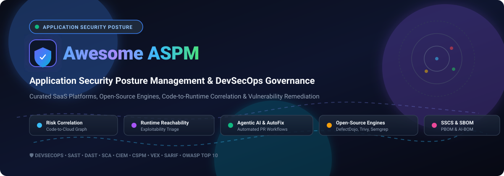

# Awesome Application Security Posture Management (ASPM) 🛡️⚡

<p align="center">
  
</p>

<p align="center">
  <a href="https://github.com/ishandutta2007/Awesome-Awesome-Awesome"></a><a href="https://discord.gg/jc4xtF58Ve"></a>
  <a href="https://github.com/ishandutta2007/Awesome-Application-Security-Posture-Management-ASPM/stargazers"></a>
  <a href="https://github.com/ishandutta2007/Awesome-Application-Security-Posture-Management-ASPM/network/members"></a>
  <a href="https://github.com/ishandutta2007/Awesome-Application-Security-Posture-Management-ASPM/issues"></a>
  <a href="https://github.com/ishandutta2007/Awesome-Application-Security-Posture-Management-ASPM/blob/main/LICENSE"></a>
  <a href="https://github.com/ishnndutta2007"></a>
</p>

---

> 🌟 **Top Curated Application Security Posture Management (ASPM), DevSecOps Orchestration, Vulnerability Prioritization & Open-Source Security Infrastructure.** 🌟

Application Security Posture Management (**ASPM**) is a pivotal DevSecOps discipline that unifies security signal intake across SAST, DAST, SCA, CSPM, and secrets detection. By establishing an intelligent code-to-cloud graph, ASPM platforms eliminate scanner alert noise, determine runtime exploitability, map business context, and route automated agentic remediation workflows directly into developer pull requests.

* **Focus Areas**: *Code-to-Runtime Context, Attack Path Analysis, Reachability Validation, SBOM/AI-BOM Tracking, Agentic AutoFix, and SDLC Governance.*
* **Last Updated**: October 2026 🚀

---

## 📑 Table of Contents

- [📊 Sector Overview & Market Dynamics](#-sector-overview--market-dynamics)
- [🏢 SaaS & Hosted ASPM Platforms](#-saas--hosted-aspm-platforms)
- [💻 Open-Source GitHub Projects](#-open-source-github-projects)
- [🏗️ Recommended Architecture: Open-Source ASPM Stack](#️-recommended-architecture-open-source-aspm-stack)
- [🤝 How to Contribute](#-how-to-contribute)
- [💖 Support & Community](#-support--community)
- [📈 Star History](#-star-history)
- [⚠️ Disclaimer](#️-disclaimer)

---

## 📊 Sector Overview & Market Dynamics

The dedicated Application Security Posture Management (ASPM) market is estimated at **$1.8B to $2.55B** in 2025–2026, growing rapidly at an annual rate exceeding 20% to 25% as organizations combat alert fatigue, scanner sprawl, and software supply chain compliance requirements. The sector remains **moderately fragmented**: while cloud security titans (e.g., CrowdStrike, Snyk, Invicti) are aggressively acquiring or bundling posture engines, specialized pure-play innovators (e.g., Apiiro, OX Security, ArmorCode) maintain strong defensibility through proprietary code-to-runtime graph correlation and agentic AI remediation rather than consolidating into a single winner-take-all outcome.

---

## 🏢 SaaS & Hosted ASPM Platforms

| 🛡️ Platform | 💼 Company Size (Valuation / Revenue) | 🏷️ Starting Tier Pricing | 🎁 Free Tier / Trial Limits | 🚀 Key Capabilities & Highlights |
| :--- | :--- | :--- | :--- | :--- |
| **[CrowdStrike Falcon ASPM](https://www.crowdstrike.com/en-us/platform/cloud-security/aspm/)** | **~$250B+ Market Cap** / ~$4.8B ARR | **£1,115/service/yr** (~$1,450/yr, 100 services MOQ on G-Cloud) or metered Falcon Flex platform contract | **15-day free trial** of Falcon Cloud Security (no credit card required) or 30-day sandbox Test Drive | Real-time cloud application mapping (microservices, APIs, data flows) via Bionic tech. Integrates runtime analysis directly into SOC detection workflows, monitoring shadow AI and reachability. |
| **[Snyk AppRisk](https://snyk.io/product/apprisk/)** | **~$3.7B–$7.4B Valuation** / ~$309M ARR | **$25/contributing dev/month** (Team tier, 5–10 devs); AppRisk platform module requires Enterprise custom plan | **Free forever tier**: up to 5 projects, 100 SAST tests/mo, 200–400 SCA tests/mo, 300 IaC tests/mo, 100 container tests/mo; or 14-day Enterprise trial | Asset discovery and posture visibility layered on Snyk. AppRisk Essentials covers discovery & posture; AppRisk Pro introduces runtime insights, reachability, and third-party scanner orchestration. |
| **[Kondukto](https://kondukto.io/)** *(Invicti)* | **~$625M Parent Valuation** (Invicti) / ~$40M–$64M ARR | **~$6,000–$7,000/yr** (Invicti entry tier for limited targets); enterprise ASPM custom quoted by asset count | **7-day free trial** of Invicti (up to 5 targets) or scheduled proof-of-concept for Kondukto ASPM platform | Orchestrates & normalizes findings across SDLC. Integrated with Invicti's runtime-validated DAST for proof-based vulnerability prioritization, eliminating false positives. |
| **[Apiiro](https://apiiro.com/)** | **~$500M–$600M Valuation** / ~$135M Total Funding | **~$55,000/yr** median enterprise starting contract (priced per Agent Compute Unit / repo scope) | **14-day free trial** with full platform evaluation and application inventory build | Deep Code Analysis (DCA) mapping runtime traffic to exact API controllers down to file and line level. AutoFix Agent automates developer remediation across Fortune 500 codebases. |
| **[OX Security](https://www.ox.security/)** | **~$250M–$500M Valuation** / ~$94M Total Funding ($10M+ ARR) | **~$350/month** entry-level baseline; ~$1,000/dev/yr ($100k/yr for 100 devs on AWS Marketplace) | **14-day free evaluation** via 'Start Free' trial registration or custom enterprise PoC | Active ASPM leveraging Code Projection and Pipeline Bill of Materials (PBOM). Unifies 10 native scanners and 120+ third-party tools into evidence-backed risk analysis. |
| **[Mend.io](https://www.mend.io/)** | **~$250M–$500M Est. Valuation** / ~$121M Total Funding | **$1,000/contributing dev/year** (Mend AppSec); $300/dev/yr (AI Security); $250/dev/yr (Renovate Enterprise) | **Free forever plan** for Open Source maintainers via Mend Renovate Community / Mend Bolt (free scanner extension) | Full-stack posture visibility across code packages, AI models, and agents (SBOM/AI-BOM). Offers continuous red-teaming simulations and in-application runtime protection. |
| **[ArmorCode](https://www.armorcode.com/)** | **~$200M–$277M Valuation** / ~$81M Total Funding | **~$4,500/year** (AWS Marketplace Bronze tier entry); mid-market & enterprise custom quoted | **14-day guided proof-of-concept (PoC)** / live sandbox environment upon demo verification | Powered by 40B+ findings and 320+ tool integrations. Features Anya, an agentic AI security champion with Model Context Protocol (MCP) server support for automated Jira and CI/CD actions. |
| **[Legit Security](https://www.legitsecurity.com/)** | **~$100M–$250M Valuation** / ~$70M–$80M Total Funding | **~$15,000–$25,000/yr** estimated enterprise entry contract (AWS Marketplace SaaS Contract by contributor scope) | **14-day free trial** for secrets detection / AI code capabilities; free open-source GitHub/GitLab posture tool (Legitify) | AI-native ASPM spanning code-to-cloud discovery, automated risk scoring, and AI-generated PR fixes. Strong focus on governance of AI coding assistants and supply chain integrity. |
| **[Jit](https://www.jit.io/)** *(Torq)* | **~$70M Acquisition Valuation** (Torq) / ~$46.7M Total Funding | **$50/contributing dev/month** (Growth tier); custom enterprise contracts via AWS Marketplace | **Free forever tier**: 1 developer seat on managed infrastructure with core SAST, SCA, secrets, and IaC PR scans | Developer-first 'shift left' ASPM integrating orchestration into pull requests. Built-in scanners and Company Context Graph align security plans to automated remediation. |

---

## 💻 Open-Source GitHub Projects

The following table indexes leading open-source security projects, vulnerability management frameworks, and scanning engines essential for assembling or orchestrating an ASPM layer. Repositories are sorted in **descending order by GitHub stars**.

| 📦 Project | ⭐ Stars | 📂 Category / Role | 📜 License | 🔍 Summary & ASPM Fit |
| :--- | :--- | :--- | :--- | :--- |
| **[Trivy](https://github.com/aquasecurity/trivy)** | [](https://github.com/aquasecurity/trivy/stargazers) | Multi-Purpose Scanner (SCA, Container, IaC, Secrets) | Apache 2.0 | Comprehensive, high-velocity scanner covering container images, file systems, Git repositories, virtual machine disks, and Kubernetes environments. Serves as a primary data feed for ASPM posture engines. |
| **[Nuclei](https://github.com/projectdiscovery/nuclei)** | [](https://github.com/projectdiscovery/nuclei/stargazers) | DAST / Vulnerability Scanner | MIT | Fast and customizable vulnerability scanner driven by community-curated YAML templates. Ideal for dynamic endpoint discovery and validating exploitable web/API vulnerabilities in runtime. |
| **[Gitleaks](https://github.com/gitleaks/gitleaks)** | [](https://github.com/gitleaks/gitleaks/stargazers) | Secrets Detection | MIT | High-performance secrets scanner protecting Git repositories against leaked API keys, tokens, and credentials in commits and pre-commit hooks. Integrates natively with ASPM aggregation platforms. |
| **[TruffleHog](https://github.com/trufflesecurity/trufflehog)** | [](https://github.com/trufflesecurity/trufflehog/stargazers) | Secrets & Credential Validation | AGPL-3.0 | Searches repositories, S3 buckets, Docker containers, and CI logs for high-entropy strings and 800+ credential types with live cryptographic verification against target services. |
| **[Semgrep](https://github.com/semgrep/semgrep)** | [](https://github.com/semgrep/semgrep/stargazers) | SAST Engine | LGPL-2.1 | Fast, lightweight static analysis engine with expressive YAML syntax matching code patterns across 30+ programming languages. Essential scanner feed for code vulnerability discovery. |
| **[Prowler](https://github.com/prowler-cloud/prowler)** | [](https://github.com/prowler-cloud/prowler/stargazers) | CSPM / Cloud Security Posture | Apache 2.0 | Security tool for cloud configuration assessment, auditing, and hardening across AWS, Azure, GCP, and Kubernetes. Feeds cloud asset infrastructure posture into ASPM correlation graphs. |
| **[CodeQL](https://github.com/github/codeql)** | [](https://github.com/github/codeql/stargazers) | Deep Semantic SAST | MIT (Queries) | Industrial-strength semantic code analysis engine querying codebases as relational data. Delivers deep inter-procedural data-flow tracking to isolate taint sources and critical sinks. |
| **[Checkov](https://github.com/bridgecrewio/checkov)** | [](https://github.com/bridgecrewio/checkov/stargazers) | IaC Security & Compliance | Apache 2.0 | Static code analysis tool for infrastructure-as-code (Terraform, CloudFormation, Kubernetes, Helm, ARM). Prevents cloud misconfigurations before deployment to validate environment posture. |
| **[OWASP DefectDojo](https://github.com/DefectDojo/django-DefectDojo)** | [](https://github.com/DefectDojo/django-DefectDojo/stargazers) | Vulnerability Management / Aggregation | BSD-3-Clause | Industry-standard open-source vulnerability management and orchestration platform with 180+ security tool parsers, deduplication, Jira bidirectional sync, and metrics reporting. |
| **[Dependency-Track](https://github.com/DependencyTrack/dependency-track)** | [](https://github.com/DependencyTrack/dependency-track/stargazers) | SBOM & Supply Chain (SCA) | Apache 2.0 | Intelligent Component Analysis platform leveraging Software Bill of Materials (SBOM / CycloneDX) to identify operational and security risk, license compliance, and exploit intelligence. |
| **[ArcherySec](https://github.com/archerysec/archerysec)** | [](https://github.com/archerysec/archerysec/stargazers) | Vulnerability Orchestrator | Apache 2.0 | Open-source vulnerability assessment and management platform orchestrating multiple scanners across web, network, and source code with centralized dashboards. |
| **[Foxnode ASPM](https://github.com/valinorintelligence/foxnode-aspm)** | [](https://github.com/valinorintelligence/foxnode-aspm/stargazers) | Open-Source ASPM Dashboard | License per repo | Dedicated open-source ASPM aggregation dashboard featuring 16+ scanner parsers, AI finding triage, compliance mapping (SOC2, PCI-DSS), security scorecards (A–F), and attack path analysis. |

---

## 🏗️ Recommended Architecture: Open-Source ASPM Stack

Building an in-house open-source ASPM pipeline enables centralized visibility without proprietary vendor lock-in. A production-ready assembly includes:

```
┌────────────────────────────────────────────────────────────────────────┐
│                        DEVELOPER / SDLC PHASES                         │
│   [Git Commits]       ──>        [Pull Requests]    ──>  [Deployments] │
└───────┬──────────────────────────────────┬───────────────────────┬─────┘
        │                                  │                       │
┌───────▼──────────────────────────────────▼───────────────────────▼─────┐
│                       OPEN-SOURCE SCANNER LAYER                        │
│  • SAST: Semgrep, CodeQL                 • Secrets: Gitleaks, TruffleHog│
│  • SCA & Containers: Trivy               • DAST: Nuclei                 │
│  • IaC: Checkov                          • Cloud Posture: Prowler       │
└─────────────────────────────────┬──────────────────────────────────────┘
                                  │ (JSON, SARIF, CycloneDX SBOM)
┌─────────────────────────────────▼──────────────────────────────────────┐
│                  ASPM AGGREGATION & CORRELATION LAYER                  │
│  • Unified Ingestion: OWASP DefectDojo / Foxnode ASPM                   │
│  • SBOM Intelligence: Dependency-Track                                 │
│  • Normalization, Deduplication & Blast Radius Scoring                 │
└─────────────────────────────────┬──────────────────────────────────────┘
                                  │
┌─────────────────────────────────▼──────────────────────────────────────┐
│                    DEVELOPER ACTION & REMEDIATION                      │
│  • Bidirectional Jira Ticketing • Slack Alerts • Automated PR Blocking │
└────────────────────────────────────────────────────────────────────────┘
```

---

## 🤝 How to Contribute

We welcome community contributions! To add a new platform, update pricing tiers, or suggest open-source tooling:

1. **Fork the repository** 🍴
2. **Create a feature branch**: `git checkout -b feature/new-aspm-tool` 🌿
3. **Add or edit entries**: follow the established table structure with verifiable pricing, company metrics, and repository badges.
4. **Submit a Pull Request** with a concise description of changes.

---

## 💖 Support & Community

If this curated ASPM guide helped streamline your security architecture, please consider:
* ⭐ **Starring this repository** on GitHub
* 🍴 **Forking it** to customize for your enterprise AppSec program
* 📢 **Sharing with your network** on LinkedIn, X/Twitter, or Reddit
* ☕ **Buying a coffee or becoming a sponsor**: Visit our [GitHub Sponsors Dashboard](https://github.com/sponsors/ishandutta2007) to back ongoing open-source research!

---

##  Star Histoyy
[](https://star-history.dera.page/#ishandutta2007/Awesome-Application-Security-Posture-Management-ASPM&type=date&legend=top-left)

---

## ⚠️ Disclaimer

- This curated list is maintained for educational and architectural benchmarking purposes; it does not constitute an explicit commercial endorsement.
- All product logos, trademarks, and valuations are the property of their respective owners.
- Security telemetry and vulnerability findings contain sensitive operational data; ensure appropriate encryption, RBAC, and data retention controls are applied across all ASPM and aggregation deployments.

---

<p align="center">
  <b>Built with ❤️ for Security Engineers, DevSecOps Champions, and AppSec Leaders.</b><br/>
  <i>Making Application Security Posture Management transparent, automated, and developer-friendly.</i>
</p>
